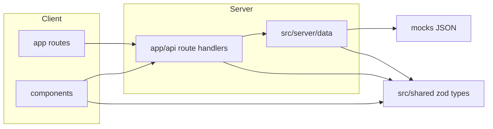

# Threadline frontend shell — implementation plan

## Current state (at plan time)

Repository was greenfield: `.gitignore`, `LICENSE` only. No `package.json`.

## Governing workflow

- Work proceeds in 10 steps (below). Each step is implemented, then `npm run typecheck` and `npm run lint` are run.
- **Dependencies:** `next`, `react`, `react-dom`, `typescript`, `tailwindcss`, `postcss`, `autoprefixer` (if needed by Tailwind major version), `eslint`, `eslint-config-next`, shadcn peer deps (`class-variance-authority`, `clsx`, `tailwind-merge`, `lucide-react`, `@radix-ui/*` as needed per component), `zod`, `react-markdown`, `remark-gfm`, `mermaid`, `dompurify`, `@types/dompurify`, `tsx` (dev, for `check:mocks` script).
- **Boundary:** UI and routes never import from `mocks/`; only `src/server/data/` reads fixtures.

---

## Step 1 — Scaffold Next.js + Tailwind + shadcn + strict TS ✅

Runnable app with empty shell routes, agent placeholder, quality scripts (`dev`, `build`, `start`, `typecheck`, `lint`). Minimal shadcn components installed as needed (`button`, `input`, `badge`, `tabs`, `scroll-area`, `skeleton`, `separator`, `tooltip`). `src/agent/README.md` placeholder.

## Step 2 — Data contracts + mock fixtures + `check:mocks` ✅

`src/shared/{ticket-id,ticket,events,api}.ts` zod schemas + inferred types. `mocks/tickets/*.json` (3-4 tickets across phases, one with conflicts + answered/superseded questions). `mocks/events/*.json` for SSE replay. `scripts/check-mocks.ts` validates fixtures; `npm run check:mocks`.

## Step 3 — Data access layer + REST route handlers ✅

`src/server/data/{mock-store,tickets,errors}.ts`. Routes: `GET /api/tickets`, `POST /api/tickets`, `GET /api/tickets/[id]`. Zod-validated inputs, 400 on bad ID, no stack traces in error responses.

## Step 4 — Layout + sidebar + empty state ✅

`src/app/layout.tsx` sidebar + main area. `src/components/sidebar/*`: add-ticket form (validates `TicketId`, inline error, Enter submits), ticket list (phase badge, running spinner, relative time, active highlight, sorted by `updatedAt`). Empty state on `/`.

## Step 5 — Ticket route: header + URL-synced tabs shell ✅

`src/app/tickets/[id]/page.tsx`. `TicketHeader` (id, title, phase, repo, cost, last updated, action buttons). `TicketTabs` synced to `?tab=` (`overview|sources|brief|plan|activity`, default `overview`).

## Step 6 — Overview tab ✅

Conflicts (highlighted, top), open questions (askedBy, waitingOn, source icon, link), "what changed since last update".

## Step 7 — Sources tab ✅

Source filter chips (jira/slack/gitlab) over one timeline of `SourceItem`s; Slack topics as cards (status, decisions, open questions).

## Step 8 — Brief + Plan tabs ✅

`SafeMarkdown` (react-markdown + remark-gfm, no raw HTML, images as links), `SafeLink` (http(s) only, hostname display, `target=_blank rel=noopener noreferrer`), `MermaidBlock` (dynamic import, `securityLevel: strict`, `htmlLabels: false`, DOMPurify SVG sanitize, rendered only while Plan tab active). Plan checkpoint bar (Approve / Request changes / Ask question — mock).

## Step 9 — Activity tab + SSE + action buttons ✅

`GET /api/tickets/[id]/events/stream` SSE route replaying mock events with delays + heartbeat. Action buttons (Fetch/Brief/Plan/Cancel) POST to a mock actions route that triggers fake event sequences. Client `EventSource` consumer with auto-scroll that pauses on manual scroll-up.

## Step 10 — Polish ✅

Loading/error states, focus styles, `README.md` (run instructions, architecture, where `src/agent/` plugs in), Vercel deploy notes for the mock demo.

---

## Cross-cutting decisions

1. **"Running" indicator:** computed from in-memory action state in the data layer, not stored in static fixture JSON.
2. **Mock persistence:** in-memory only; POST-added tickets are ephemeral (reset on server restart), matching Vercel serverless mock-demo constraints.
3. **Tab default:** invalid/missing `?tab=` falls back to `overview`.
4. **404 ticket:** dedicated not-found UI via Next `notFound()`.
5. **Strict markdown:** `react-markdown` renders raw HTML as literal text (no `rehype-raw`, no `dangerouslySetInnerHTML`).
