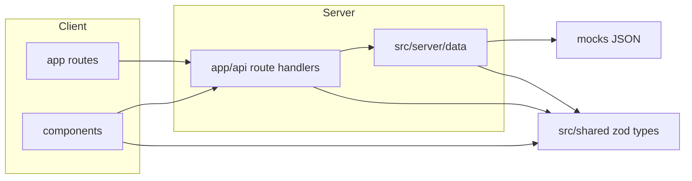

# Threadline

Everything about a work ticket — Jira description and comments, Slack threads,
GitLab merge requests — in one place: status, open questions (who asked, who
we're waiting on), conflicts, and what changed since the last update.

This repository is the **frontend shell**: layout, data contracts, and
mock-backed API routes, with safe rendering of untrusted content (markdown,
mermaid diagrams, links). There is no agent/LLM logic here yet; see
[Where the agent plugs in](#where-the-agent-plugs-in).

## Running locally

```bash
npm install
npm run dev
```

Then open [http://localhost:3000](http://localhost:3000).

Scripts:

- `npm run dev` — start the dev server
- `npm run build` / `npm run start` — production build and serve
- `npm run typecheck` — `tsc --noEmit`
- `npm run lint` — ESLint
- `npm run check:mocks` — validate every fixture in `mocks/` against the zod
  schemas in `src/shared`

## Architecture



- `src/shared` — zod schemas and inferred types for the domain (`Ticket`,
  `OpenQuestion`, `Topic`, `Conflict`, `Change`, `SourceItem`, `AgentEvent`,
  `TicketDetail`) and the API request/response shapes. Pure TypeScript, no
  React or Next.js imports.
- `src/server/data` — the only code that reads `mocks/`. `mock-store.ts`
  seeds an in-memory `Map` from the fixtures; `tickets.ts` and
  `agent-actions.ts` / `event-stream.ts` are the data-access functions
  everything else calls.
- `src/app/api` — thin route handlers that validate input, call into
  `src/server/data`, and return JSON (or an SSE stream for
  `events/stream`).
- `src/app` — routes. `page.tsx` is the empty state; `tickets/[id]/page.tsx`
  is the ticket screen, with `loading.tsx` / `error.tsx` / `not-found.tsx`
  for that route segment.
- `src/components` — UI. Components never import from `mocks/` directly;
  they go through the API routes (client components) or the data-access
  layer (the one server component, `tickets/[id]/page.tsx`).
- `src/agent` — empty placeholder. See below.

## Where the agent plugs in

`src/agent/` is reserved for the real agent harness — fetching from
Jira/Slack/GitLab, summarizing, drafting plans — built by hand later,
outside this shell. It's pure TypeScript with no dependency on React or
Next.js, so it can run standalone (CLI, worker, cron). When it exists,
`src/server/data` is the seam: swap the in-memory mock store for whatever
the agent actually produces, without touching routes or components.

## Mock data vs. real data

Everything in this repo currently runs on static fixtures:

- Ticket list/detail data comes from `mocks/tickets/*.json`, validated
  against `TicketDetailSchema`.
- The Activity tab and the header's action buttons (Fetch/Brief/Plan/Cancel)
  replay `mocks/events/*.json` on a timer — they only emit fake events; no
  ticket data (brief, plan, sources) is ever generated.
- All of this lives in an in-memory `Map`, so it resets on server restart
  (or a fresh serverless invocation). Tickets added via "Add ticket" and the
  fake activity log don't persist.

Real data — actually talking to Jira/Slack/GitLab and running an agent — is
intended to run locally only, once `src/agent/` exists and `src/server/data`
is pointed at it.

## Deploying to Vercel

The app deploys to Vercel with no extra configuration: it's a standard
Next.js App Router project with no environment variables and no external
services. Keep in mind it's a **mock-data demo** when deployed:

- Every serverless invocation gets its own in-memory store, so added
  tickets and running actions aren't as consistent across requests as they
  are in a single long-running `next dev` / `next start` process.
- The Activity tab's SSE connection relies on the Node.js runtime (the
  default here) and stays open for the duration of a fake run; Vercel's
  function execution limits can cut unusually long-lived connections.

Real (non-mock) data is out of scope for the Vercel deployment — it's
local-only, as described above.
